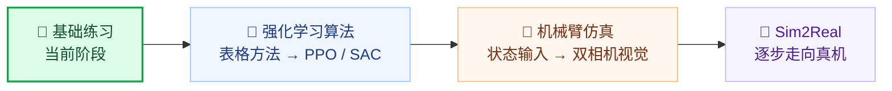

  

<h1 align="center">🌱 从零开始的强化学习</h1>

  <strong>一个新手的学习笔记，欢迎批评、纠错和一起交流。</strong> 
  从看懂一个张量开始，慢慢走向自己的算法与机器人。

  
  
  
  

  <a href="first_step/">📚 查看练习</a> ·
  <a href="强化学习指南.txt">🧭 完整学习路线</a> ·
  <a href="https://github.com/ZzxArthur/rl-learning/issues">💬 给我提个建议</a>

---

## 👋 你好，我还是一名新手

这个仓库记录我学习强化学习的过程：写过的练习、遇到的问题，以及通过实验得到的一点点理解，也方便我在不同电脑上继续学习。

之前主要跟着教程手敲代码。现在希望逐步弄清楚每一步为什么这样写，自己完成实现和验证，并且能解释程序的行为和实验结果。

部分练习参考教程完成，学习中也会查阅官方文档、借助 AI 解释概念和检查代码。我会继续练习脱离参考独立实现，把自己的理解和问题都记录下来。

> 📍 **当前进度：Python / PyTorch 基础练习。**
> 下面的 PPO、SAC 和机器人方向是后续学习计划。

## 🧩 现在在练什么？

| 主题 | 正在弄明白的问题 |
| --- | --- |
| 🔢 张量与广播 | 形状怎样对齐？为什么所有样本要共享偏置？ |
| 📉 求导与更新 | 损失、梯度和参数分别是什么？什么时候发生更新？ |
| 🧠 简单神经网络 | 线性层怎样连接？ReLU 为什么能改变表达能力？ |
| 🎲 概率与动作 | 怎样从分数得到概率，再按概率抽取动作？ |
| 🛠️ 编程习惯 | 怎样把代码写清楚、读明白，并验证自己的修改？ |

## 🧭 一步步往前走

希望先学好基础，再从表格方法、REINFORCE 和 DQN 逐步走向独立实现 PPO、SAC，建立自己的训练框架。之后继续学习机械臂仿真、腕部与全局双相机，以及 Sim2Real。

这是长期路线，我会根据实际掌握情况逐步推进。

## 📂 仓库里有什么？

| 入口 | 内容 |
| --- | --- |
| [📚 first_step/](first_step/) | 按学习顺序积累的基础练习，部分文件保留了调试说明和实验结果。 |
| [🧭 强化学习指南.txt](强化学习指南.txt) | 长期学习路线、教学方式和阶段验收要求，会随学习情况调整。 |

## 💬 欢迎批评，也欢迎一起学习

我目前经验有限，代码和理解中可能有不准确、考虑不周的地方。**如果你发现问题，很欢迎直接指出来。**

无论是公式理解、张量形状、代码结构、命名习惯，还是测试和实验结论，都欢迎通过 [Issue](https://github.com/ZzxArthur/rl-learning/issues) 交流。如果能说明问题所在、解释原因，或者推荐适合初学者的资料，我会非常感谢。

对收到的反馈，我会认真查证、学习，并结合自己的实验逐步改进。也欢迎同样从基础开始的朋友一起交流。

  <strong>感谢愿意花时间阅读、纠错和分享经验的你。🌻</strong> 
  封面为 AI 辅助生成的学习主题插画。

<!--
Cover asset: readme-cover.png (2172 × 724)
Generation mode: built-in image_gen, using the imagegen skill.
Final generation prompt:
Use case: illustration-story. Asset type: wide panoramic GitHub README cover, approximately 3:1 aspect ratio. Primary request: an original, friendly illustration for a beginner's personal reinforcement-learning and robotics learning journal. Scene/backdrop: a warm off-white, uncluttered study space. Subject: a curious little robot learning at a laptop beside an open notebook, with a small tabletop robot arm exploring colorful blocks; subtle floating neural-node and tensor-grid motifs connected by a gently dotted learning path. Style/medium: polished editorial illustration with soft three-dimensional forms, rounded shapes, tactile matte surfaces, carefully drawn playful details. Composition/framing: wide horizontal banner with balanced spacing, complete subjects visible, generous breathing room and clean margins; readable when displayed at GitHub README width. Lighting/mood: soft warm light, curious, lively, modest, welcoming, beginner-friendly. Color palette: warm off-white ground with teal, periwinkle, and coral accents. Constraints: conceptual illustration of learning aspirations, not a technical achievement claim; opaque background; absolutely no text, no letters, no numbers, no logos, no watermarks.
-->
